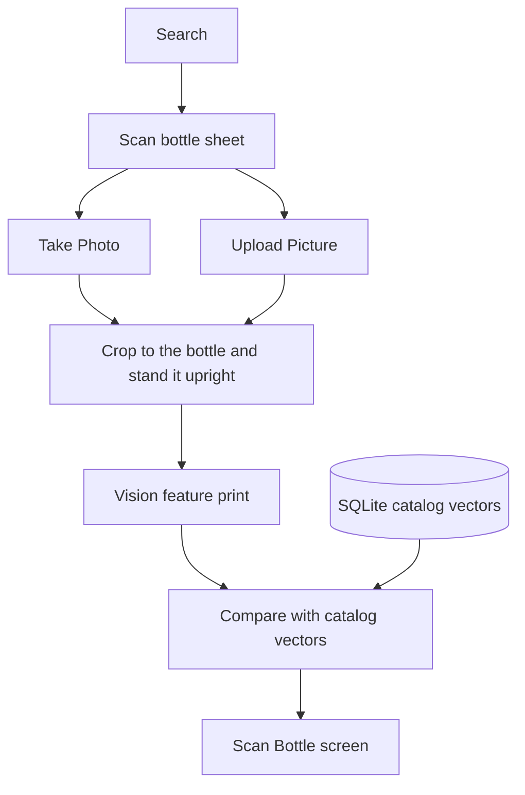

# Whiskey Scan Demo

Scan a bottle on an iPhone. The app matches the photo against a catalog that lives on the phone, offline, and shows how it decided.

**Demo:** a screen recording of Search, then four photos, then each Scan Bottle result. The photos are catalog images on a monitor, not a bottle in hand.

The image match compares the photo with the catalog pictures. It does not read the brand name. **Best guess** means the top score is under 70%, or less than 8 points ahead of the next whiskey (`src/lib/matching/config.ts`). The name on that card can still be the right bottle.

In the recording, Laphroaig 10, Johnnie Walker Black Label, and Blanton's are named correctly. Laphroaig and Blanton's stay Best guess because of that gate. Maker's Mark 2025 is a different expression from the catalog's Maker's Mark, so the image match ranks Rittenhouse Rye first. How we found it still reads "Maker's Mark" off the label. That label ranking does not change the image result.

## How a scan works

Search lists the catalog. The Scan bottle sheet takes a photo or uploads one from the library. That photo is cropped to the bottle and stood upright. Apple Vision turns it into a feature print. That print is compared with the catalog vectors in SQLite. The Scan Bottle screen shows the nearest whiskey, or Not found with best guesses. How we found it shows the winning catalog photo, the top scores, and the time. The Not found cutoff is in `src/lib/matching/config.ts`.



The first launch embeds every catalog photo in the background and saves those vectors. There is no progress indicator. A scan before that finishes can say Not found. A photo that fails to embed is tried again on the next launch. Later launches reuse the stored vectors. The model id is the feature print's element type and count. When that id changes, every stored vector is cleared and embedded again.

Matching runs on a physical iPhone. The iOS Simulator can show the UI, and it cannot create a feature print. Android can build, and embedding is iOS-only, so a scan there does not match.

## Bring your own photos

Catalog photos are not in git. Generate `assets/catalog/` before the first run. The app will not bundle without it. Use photos you have the rights to ship.

Run the commands in this directory. You need Node 22, Xcode, and a physical iPhone.

```bash
npm run catalog -- "/path/to/your/photos"
```

A CLI path wins over `WHISKEY_PHOTOS_DIR` when both are set.

The source folder needs `whiskey_bottles.csv`. `data/whiskey_bottles.csv` is the demo metadata for the 50 whiskeys. Required columns: `#`, `name`, `producer`, `expression`, `age`, `style`, `note`, `folder`, `photo1`, `photo2`, `photo3`, `photo4`. Extra columns are ignored. `folder` is a subfolder name, matched exactly, including dashes and apostrophes. A photo cell looks like `1-front.jpg | image: https://… | page: https://…`. Only the file name is copied. Photos must be JPEG. Any other format stops the build and leaves the previous catalog in place.

Without `crop_report.csv`, each whiskey uses `photo1`–`photo4`, and `photo1` is the card image. If the folder also has `crop_report.csv` (`bottle`, `output_files`, `status`), those files replace `photo1`–`photo4`. Rows with status `cropped`, `partial`, or `split` are kept. `flagged` rows are dropped. `output_files` is a semicolon-separated list and may name one subfolder, such as `partial/label.jpg`. The card image is the first kept file.

The script checks every named folder and photo before it writes anything. It resizes each JPEG so the long edge is at most 1024 px, then swaps in `assets/catalog/` (`catalog.json`, `image-map.js`, and the photos). Reload the app after a rebuild so Metro picks up `image-map.js`. New photos are embedded on the next launch.

## Get started

```bash
npm install
npx expo run:ios --device
```

This is a dev client, not Expo Go. Camera, SQLite, and image embedding need the native build.

```bash
npm run check
npm test
```

## Cloud builds

`.easignore` lists what a cloud EAS upload leaves out. It follows `.gitignore`, except it does not ignore `assets/catalog/`, so a build can bundle a catalog you generated locally. Generate the catalog before the upload. This repo does not add an EAS project.

## Next

- Read the label and show a separate ranking of catalog names by those words. That ranking does not change the photo match.
- Look-alikes: after that label text exists, use it with the photo score so two ages from the same distillery can split.
- Web fallback: when nothing in the catalog is confident, look the label up on the web.
